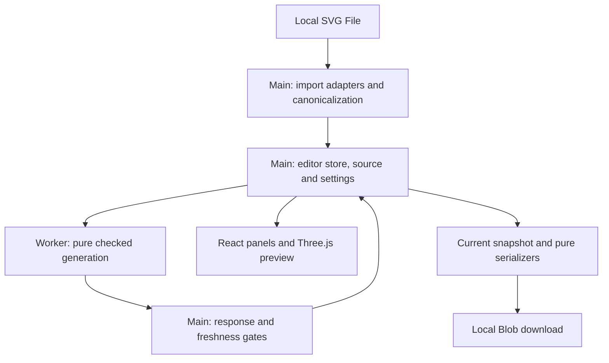

# New-SDE whiteboard walkthrough

Use this as a 25-minute live session with the current editor and source open.
The goal is to trace one SVG to a downloadable coin, then explain why stale or
invalid geometry cannot leave the editor. Detailed contracts remain in the linked
design notes; release progress and acceptance evidence remain in Linear.

## 1. Draw the boundaries — 3 minutes

CoinPrint is a static React/TypeScript app. GitHub Pages serves the root
`index.html` and bundled assets. Files stay in the browser: there is no backend,
authentication or processing upload. The main thread owns file import, editor
state, rendering and serialization; a module Worker owns mesh generation.



The store sends only source/settings DTOs to the Worker. The gate accepts only
the active request. Rendering consumes checked snapshots through selectors;
camera transforms and GPU buffers never flow back into generation or export.

| Boundary | Source entry points | Responsibility |
| --- | --- | --- |
| File/XML and library adapters | [`import/importCoinSvg.ts`](../app/src/import/importCoinSvg.ts), [`import/svgLoaderAdapter.ts`](../app/src/import/svgLoaderAdapter.ts) | Detached SVG parsing, layer/source mapping, curve extraction; polygon-clipping and Earcut adapters live in `import/` too. |
| Domain | [`core/contracts.ts`](../app/src/core/contracts.ts), [`core/generateCoin.ts`](../app/src/core/generateCoin.ts) | JSON data, canonical footprints, stacking, construction, independent validation and pure serialization; no editor or scene state. |
| Coordination | [`state/editorStore.ts`](../app/src/state/editorStore.ts), [`worker/generationTransport.ts`](../app/src/worker/generationTransport.ts) | Atomic import, settings revisions, cancellation, checked-result ownership and export eligibility. |
| Presentation/delivery | [`components/AppShell.tsx`](../app/src/components/AppShell.tsx), [`preview/partView.ts`](../app/src/preview/partView.ts), [`state/exportCoin.ts`](../app/src/state/exportCoin.ts) | Accessible controls, disposable display copies, guarded local download. |

## 2. Trace import — 4 minutes

Open [`fixtures/svg/sun-medallion.svg`](../fixtures/svg/sun-medallion.svg).
Follow `readLocalCoin → importCoinSvg → normalizeSvg → canonicalizeSvg`.

1. Read a bounded local file and parse detached XML. Preflight rejects scripts,
   resource references and unsupported printing features before SVGLoader.
   Source XML is never mounted into the page.
2. Discover named Inkscape layers in document order; the first is the base.
   Nested printing layers reject. Map source elements by structural paths and
   stable identities; labels supply readable names, not unique identity.
3. Extract supported closed filled shapes, apply inherited transforms, resolve
   physical units/viewBox and invert SVG Y once into canonical +Y-up millimeters.
   Inferred sizing carries a warning.
4. Flatten curves with bounded chord error, interpret nonzero/evenodd fills,
   preserve holes/islands and union each layer into `FootprintMm`. The imported
   base must be one connected region. Seed color from the first printable object.
5. Commit only a complete `ImportedCoin` and separately created `CoinSettings`.
   The store clones/freezes owned data. A rejected replacement keeps the previous
   source/settings/checked result; no partial candidate becomes current.

Draw three separate boxes: **immutable ImportedCoin**, **editable CoinSettings**,
**derived GeneratedCoin**. Source footprints are the stable cached 2D work;
thickness edits do not parse, flatten or union the SVG again.

## 3. Build the solid — 6 minutes

Follow [`resolveStack`](../app/src/core/resolveStack.ts),
[`validateSupport`](../app/src/core/validateSupport.ts), then `generateCoin`.

Settings are internally bottom-to-top even though layer cards display the base
at the bottom. The base stays first/enabled; hidden artwork contributes neither
height nor material. Active tiers get cumulative absolute Z intervals from Z=0.
Defaults are 1.6 mm for the base and 0.4 mm per artwork tier.

For original active footprints F, the effective footprint is
`E[i] = union(F[i], E[i+1])`, starting at the top. Support propagates downward
through every lower tier, including the base. It uses each lower tier's color
and existing Z interval. It can fill holes, enlarge the outline or create detached
columns to Z=0; it does not bridge columns or modify source artwork. Hiding the
upper artwork removes its support on the next generation.

The supported stack produces two representations:

| Output | Construction and use |
| --- | --- |
| Closed parts | One extruded, closed mesh per active tier, including holes/islands. Preview and 3MF consume these. Adjacent parts intentionally have coincident caps. |
| Unified exterior | Base bottom, exposed terraces `E[i] - E[i+1]`, final top and tier walls; conform shared boundaries before stitching. STL consumes this. Concatenating closed parts would leave internal caps. |

Construction success is insufficient. `generateCoin` independently checks actual
part and unified coordinates against retained effective footprints: manifold
edges/vertex links, winding, shell counts, intersections, bounds, volume and
exact tier-surface coverage. Expected shell count follows effective base regions,
so detached supported columns can be valid. Failed generation carries diagnostics
and no meshes, dimensions or metrics. See [headless generation](headless-generation.md)
and [downward support](support-validation.md).

Whiteboard check: three centered, nested squares of 20×20, 10×10 and 4×4 mm,
with thicknesses 2, 0.6 and 0.4 mm, have Z intervals `[0,2]`, `[2,2.6]`,
`[2.6,3]` and volume `400×2 + 100×0.6 + 16×0.4 = 866.4 mm³`.
Hide the middle square: the top starts at Z=2, total height becomes 2.4 mm,
and volume becomes 806.4 mm³. This is an illustrative calculation, not fixture data.

## 4. Explain races and failures — 5 minutes

```mermaid
sequenceDiagram
  participant UI as Editor controls
  participant Store as Editor store
  participant Worker as Generation Worker
  participant Export as Export action
  UI->>Store: Commit thickness, settings revision r
  Store->>Worker: Generate with token t and source revision s
  UI->>Store: Commit another geometry edit, revision r+1
  Store->>Worker: Terminate old job; generate with token t+1
  Worker-->>Store: Result with version, token, source and settings keys
  alt Active request and geometry match
    Store->>Store: Check submitted result; own checked snapshot
    UI->>Export: Download selected format
    Export->>Store: Read current exportable snapshot
    Export->>Export: Serialize and validate emitted coordinates
    Export->>Store: Recheck snapshot and source identity
    Export-->>UI: Create local download
  else Stale response
    Store->>Store: Ignore without replacing current state
  end
```

Request acceptance checks protocol version, monotonic token, source revision,
import identity and submitted settings revision. The store also checks the
active request, exact owned source reference and ordered geometry settings.
Same-file reimports still have new import identities. Cancellation terminates
CPU work; identity checks independently prevent late results from committing.

Color-only edits increment revision but reuse checked or compatible in-flight
geometry after proving every geometry setting unchanged and colors valid.
Only metadata is projected to the new revision; geometry edits cannot use this
path. Selection/camera changes do not regenerate.

Worker transfer uses owned Float64 positions and Uint32 indices, then hydrates
domain tuples on main. Preview buffers are separate lossy Float32 copies.
Worker failures surface `GENERATION_WORKER_FAILED` and Retry; there is no
synchronous fallback. Preview/WebGL failure leaves text diagnostics and editing
available. Pending import/generation disables export; retained `previousValid`
never authorizes it. Invalid generation clears that retained snapshot.
See [revision protocol](reactive-generation.md) and [Worker ownership](background-generation.md).

## 5. Follow export to bytes — 4 minutes

`exportCurrentCoin` reads `selectExportableGeometry`, invokes the pure writer,
then rechecks the exact snapshot, source revision and source identity before
download. Eligibility in the store and validity of emitted coordinates are
separate checks.

| Format | Bytes and tradeoff |
| --- | --- |
| [Binary STL](binary-stl-export.md) | Unified exterior; float32 XYZ, 80-byte header, triangle count, 50 bytes per triangle. Coordinates represent mm, but STL has no unit/color/layer field. Float32 cleanup is bounded to 0.001 mm vertex displacement and actual output is revalidated; unrepairable output rejects. |
| [Layered 3MF](layered-3mf-export.md) | ZIP/OPC with one build item referencing an assembly of closed named parts, absolute XYZ and explicit millimeters. Round-trip number text preserves coordinates; emitted geometry and XML metadata are checked. Display-color materials express intent, not printer filament assignments or an OrcaSlicer project. |

Both downloads use the imported filename with a sanitized format suffix.
Blob/Object URL cleanup belongs to the download adapter. A triggered browser
download does not prove that the OS saved a file.

## 6. Close with change locations and limits — 3 minutes

Use these prompts to check the new SDE's understanding:

- **A color picker change causes clipping calls.** Inspect `editorStore`'s
  geometry-equivalence/recolor path and `tests/unit/editor-store.test.ts`.
- **Moving artwork outside the original base changes lower layers.** Explain
  derived downward support; inspect `tests/unit/forced-support-generation.test.ts`.
- **The preview looks correct but STL fails.** Check output precision validation,
  not camera state; inspect `tests/unit/binary-stl.test.ts`.
- **A delayed result replaces newer artwork.** Inspect Worker protocol/transport
  and store ownership gates; `tests/unit/generation-worker.test.ts` exercises them.

Supported SVG is deliberately narrower than general SVG: live text, strokes,
images, references, gradients, masks and clip paths need authoring changes.
Point contacts, ambiguous tiny geometry and work-budget exhaustion can still
reject. Import and serialization remain on main, so the Worker does not make
every phase nonblocking. Generic 3MF colors do not promise consumer filament
behavior, and automated mesh/package checks do not establish physical-print
acceptance. Consult Linear for current manual gates and follow-up priorities.

For maintenance, `npm run typecheck`, `npm test` and `npm run check:pages` are
the normal verification path. Source entry is `app/index.html`; root
`index.html`/`assets` are generated. Source changes require `npm run build:pages`
and synchronized artifacts; publication remains main/root with relative assets.
The [README](../README.md) documents setup and guarded publication.
